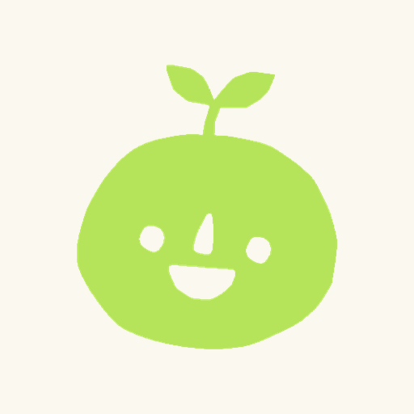

<p align="center">
  
</p>

<h1 align="center">TouchGrass</h1>

<p align="center">
  <b>Quédate con Instagram y TikTok. Olvídate del scroll infinito.</b><br>
  Una app Android que bloquea los Reels y el Para ti, y nada más.
</p>

<p align="center">
  <a href="../../releases/latest"></a>
  
  
</p>

<p align="center">
  <a href="README.md">🇬🇧 English</a> · 🇪🇸 Español
</p>

---

TouchGrass funciona **por encima de las apps oficiales**. Sigues usando Instagram y TikTok
para lo que de verdad quieres (mensajes, publicaciones de tus amigos, historias, perfiles),
pero en cuanto entras en el scroll de vídeos, una pausa a pantalla completa lo tapa.

Si de verdad quieres verlos, pides unos minutos de un **saldo diario** que eliges tú. Cuando
se acaban, vuelve la pausa.

## Qué hace

- **Bloquea solo el scroll.** Los Reels de Instagram (la pestaña y el visor) y las pestañas
  *Para ti* y *Comunidad* de TikTok. Todo lo demás queda libre.
- **Excepciones con sentido.** Un reel que abres desde un perfil, un chat, Inicio o Guardados
  se ve con normalidad. Desde un chat, Inicio o Guardados, al pasar al siguiente reel sale la
  pausa.
- **Saldo diario.** Eliges cuántos minutos al día puedes desbloquear (hasta 4 h). El día se
  renueva a las 8:00. Bajar el límite se aplica al momento; subirlo, a partir del mes siguiente.
- **Pedir tiempo, con motivo.** Eliges la app, los minutos y para qué (Baño, Comer, Bus,
  Pasatiempo, Dormir u Otro, con texto). Si terminas antes, se devuelve lo que sobra, en
  múltiplos de 5 minutos.
- **Estadísticas que motivan.** Una cara para cada día, rachas de días con poco uso, un
  calendario del mes y cuántas veces te frenó la pausa.
- **Difícil de saltar.** Los desbloqueos se miden con un reloj que no se puede cambiar, el
  saldo exige fecha y hora automáticas, y quitar la protección queda apuntado.
- **Silencia el scroll.** Mientras se ve la pausa, el vídeo no suena y los botones de volumen
  no hacen nada.
- **Privacidad total.** Sin permiso de Internet, sin cuentas y sin analítica. Nada sale de tu
  móvil.

## Cómo funciona

TouchGrass usa el **servicio de accesibilidad** de Android, limitado a Instagram, TikTok y la
pantalla de inicio. Solo mira los *identificadores* internos de los botones que hay en
pantalla (por ejemplo, «pestaña de Reels, seleccionada») y, en TikTok, el nombre de las
pestañas de arriba. Nunca lee mensajes, textos de publicaciones, nombres ni lo que escribes.

Cuando esos identificadores coinciden con una zona bloqueada, TouchGrass pone encima una
pausa a pantalla completa. La app oficial sigue funcionando debajo: no se modifica, ni se
inyecta, ni se parchea nada.

Las reglas de detección están en pequeños ficheros JSON (`app/src/main/assets/rules/`), para
poder actualizarlas cuando Instagram o TikTok cambien sus apps.

## Descargar e instalar

TouchGrass no está en Play Store. Se instala desde las
[Releases de GitHub](../../releases/latest).

1. **Descarga la APK.** Desde el móvil, abre la [última Release](../../releases/latest) y
   descarga `touchgrass-vX.Y.Z.apk` (en *Assets*). Ábrela y pulsa *Instalar*. Android te pedirá
   permitir instalar apps desde el navegador o el gestor de archivos.
2. **Permite los ajustes restringidos** (Android 13 o superior). Android bloquea la
   accesibilidad a las apps que no vienen de una tienda. Ve a *Ajustes → Aplicaciones →
   TouchGrass → ⋮ → Permitir ajustes restringidos*. Si no aparece la opción, intenta primero
   activar la protección (paso 4): al rechazarlo una vez, la opción aparece.
3. **Primeros pasos.** TouchGrass te pide tu nombre (opcional), te explica cómo funciona y te
   pide tu límite diario. Antes de activar la protección te enseña qué lee el servicio y qué no,
   y te pide tu permiso.
4. **Activa la protección.** Pulsa *Activar en Accesibilidad* y activa TouchGrass. Al volver a
   la app debe poner *¡Listo! El scroll ya está bloqueado.*

### Xiaomi, Redmi y POCO (HyperOS / MIUI)

Estos sistemas cierran las apps en segundo plano con mucha facilidad. Android vuelve a poner
en marcha la protección en unos segundos, pero solo si el sistema le deja:

- En *Ajustes → Aplicaciones → TouchGrass*, activa **Autoinicio** y en **Ahorro de batería**
  elige **Sin restricciones**. La app enseña este consejo, con un acceso directo, en los Xiaomi.
- TouchGrass no aparece en Recientes a propósito: así no se puede cerrar deslizándola.

### Otros móviles

En Android puro (Pixel, Motorola…) no hace falta nada más. En marcas con ahorro de batería
agresivo (Samsung, Huawei, OnePlus, Oppo…), quita TouchGrass de la optimización de batería si
la protección se detiene. En Samsung: *Ajustes → Batería → Límites de uso en segundo plano →
Aplicaciones que nunca entran en suspensión*.

Probada en un Xiaomi con HyperOS (Android 14). En otras marcas debería funcionar, pero no está
verificado.

### Comprobar la descarga (opcional)

Cada Release incluye `touchgrass-vX.Y.Z.apk.sha256`:

```bash
sha256sum -c touchgrass-vX.Y.Z.apk.sha256    # debe decir OK
```

Todas las versiones van firmadas con la misma clave. Huella SHA-256 del certificado:

```
4d9cde9b128b248b103de0124f4ba33e56604af95620c538ef45f0e8af8df652
```

Se comprueba con `apksigner verify --print-certs touchgrass-vX.Y.Z.apk` (viene con el Android
SDK).

## Actualizar

TouchGrass **no se actualiza sola**: no tiene permiso de Internet, a propósito.

- **Para actualizar**, descarga la APK nueva e instálala encima de la que tienes. Como todas
  las versiones van firmadas con la misma clave, conservas el límite, el saldo y las
  estadísticas.
- **Para enterarte de las versiones nuevas**, usa *Watch → Custom → Releases* en este repo, o
  añádelo a [Obtainium](https://github.com/ImranR98/Obtainium).

Si Android dice que hay un conflicto con un paquete existente, la APK no está firmada con la
clave de TouchGrass. No la instales: descárgala solo de las Releases de este repo.

## Privacidad

- **Sin permiso de Internet** ni permisos en tiempo de ejecución: solo el servicio de
  accesibilidad, que activas tú después de leer qué hace.
- El servicio solo observa Instagram, TikTok y la pantalla de inicio, y solo guarda
  identificadores de botones. Nunca lee mensajes, publicaciones, nombres ni contraseñas, y no
  guarda lo que hay en tu pantalla.
- Tu nombre, tu límite, los desbloqueos (con su motivo) y las estadísticas se guardan solo en
  tu móvil y no se copian a la nube.

Política completa: [docs/PRIVACIDAD.md](docs/PRIVACIDAD.md) (también dentro de la app).

## Problemas frecuentes

**«TouchGrass se ha detenido».** El sistema cerró el servicio y no volvió en un minuto. Tu día
no se ve afectado: solo cuenta como trampa desactivarlo tú en Accesibilidad. Revisa el
*Autoinicio* y el ahorro de batería (ver arriba). Si sigue sin volver, en los Ajustes de la app
pulsa *Reactivar en Accesibilidad*, **desactiva** TouchGrass y **vuelve a activarlo**.

**El saldo no se renueva.** Activa la fecha, la hora y la zona horaria automáticas. Sin ellas,
el saldo se congela para que no se pueda hacer trampa con el reloj.

**Instagram o TikTok se han actualizado y el bloqueo ha dejado de funcionar.** A veces cambian
sus identificadores internos. Abre una incidencia indicando la versión de la app.

## Limitaciones

- Solo Android: iOS no permite este tipo de servicio.
- Solo Instagram y TikTok (aún no YouTube Shorts).
- Las reglas dependen de los identificadores internos de las apps oficiales, así que una
  actualización grande puede romperlas hasta que se actualicen.

## Compilar desde el código

Requisitos: JDK 17 o superior y Android SDK 37 (Android Studio trae ambos).

```bash
./gradlew assembleDebug        # APK de debug
./gradlew installDebug         # la instala en el móvil conectado por adb
./gradlew testDebugUnitTest    # tests unitarios
./gradlew ktlintCheck lintDebug
```

La versión de debug (`io.github.russian03.touchgrass.debug`) puede convivir con la de release.
Cada una tiene su propio servicio de accesibilidad.

Hecha con Kotlin, Jetpack Compose (Material 3 Expressive), Hilt y DataStore. La lógica del
bloqueo (`core/`) es Kotlin puro y está cubierta por tests unitarios.

## Licencia

© 2026 Russian03. Todos los derechos reservados. El código es público para que se pueda leer
y auditar, pero no tiene licencia de reutilización ni de redistribución.

La app incluye la fuente [Montserrat](https://fonts.google.com/specimen/Montserrat), con la
[SIL Open Font License 1.1](docs/licencias/montserrat-OFL.txt).
